<div align="center">

# Agent Workflow Explainer

**An interactive, scroll-driven build guide for an AI agent in n8n.**<br>
Chat Trigger · AI Agent · Google Gemini · Simple Memory · Google Sheets · Gmail with human approval


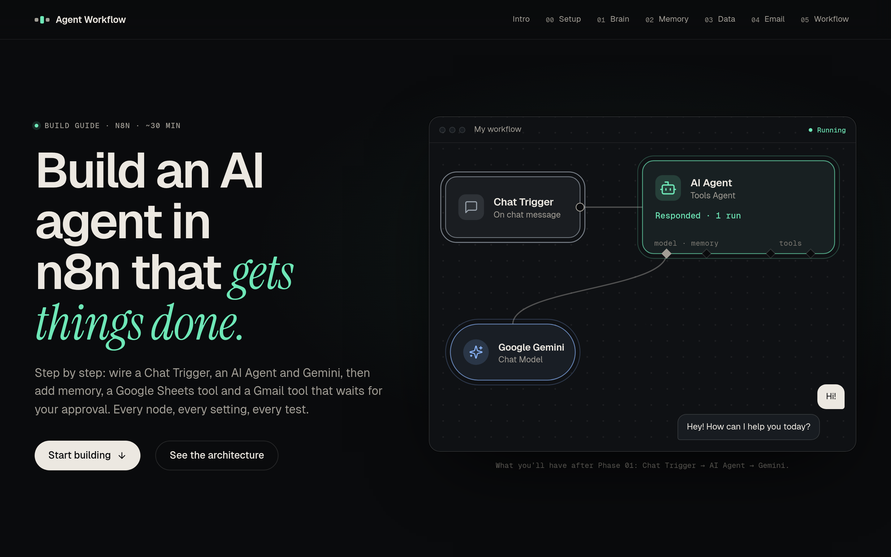

</div>

---

## Overview

This site teaches developers how to build a working AI agent in [n8n](https://n8n.io), one phase at a time. As you scroll, a single workflow canvas grows from one node to six, and each step is either something to **build** (a numbered click path with exact settings) or something to **test** (a simulated run showing what happens inside the workflow).

The content follows [`docs/project.md`](docs/project.md), and nothing on the page goes beyond what that spec establishes.

| Phase | You build | You learn |
|---|---|---|
| **Setup** | n8n Cloud workspace, Gemini API key | What you need before placing a node |
| **01 · Core agent** | Chat Trigger → AI Agent → Gemini Chat Model, plus a system message | How a trigger, an agent and a model fit together |
| **02 · Memory** | Simple Memory sub-node | Why each run is stateless until memory is attached, and how session memory works |
| **03 · Data tool** | `get_board_members` (Google Sheets tool) | How tool calling works: the model *chooses* a tool, n8n *executes* it |
| **04 · Gated action** | `send_board_email` (Gmail tool) | A draft → revise → approve → send loop, and what prompt-level approval can and can't guarantee |

## Walkthrough

The left column carries the instructions. The sticky stage on the right shows the workflow canvas, a simulated chat, and the node configuration pane for the current step.

<table>
  <tr>
    <td width="50%">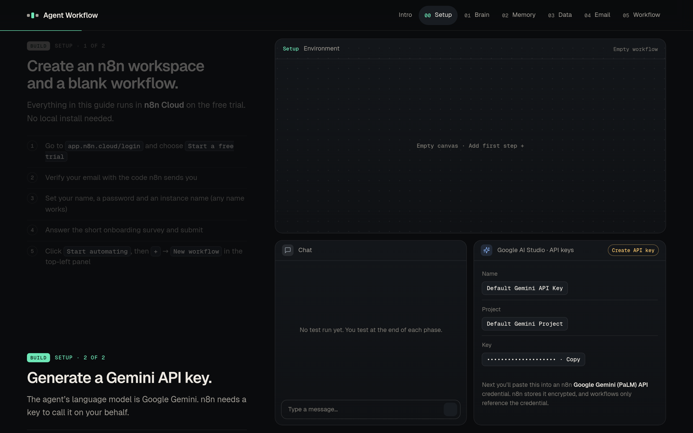<br><b>Setup.</b> n8n workspace and Gemini API key.</td>
    <td width="50%">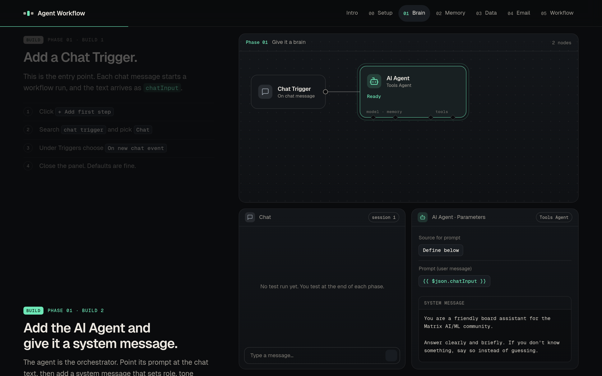<br><b>Phase 01.</b> Chat Trigger, AI Agent and system message.</td>
  </tr>
  <tr>
    <td>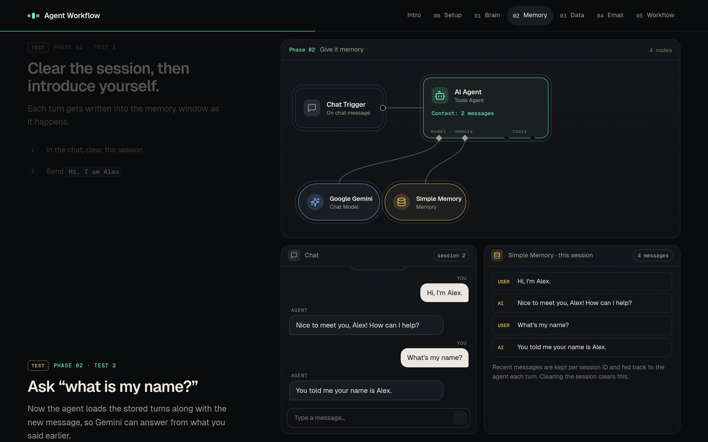<br><b>Phase 02.</b> Simple Memory, with the stored turns visible.</td>
    <td>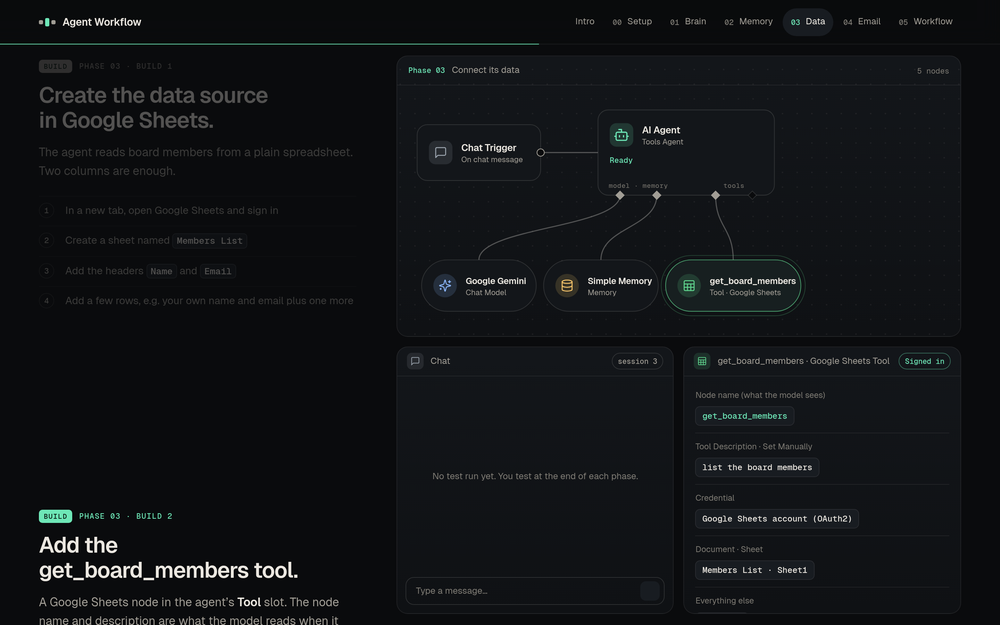<br><b>Phase 03.</b> The <code>get_board_members</code> tool.</td>
  </tr>
  <tr>
    <td>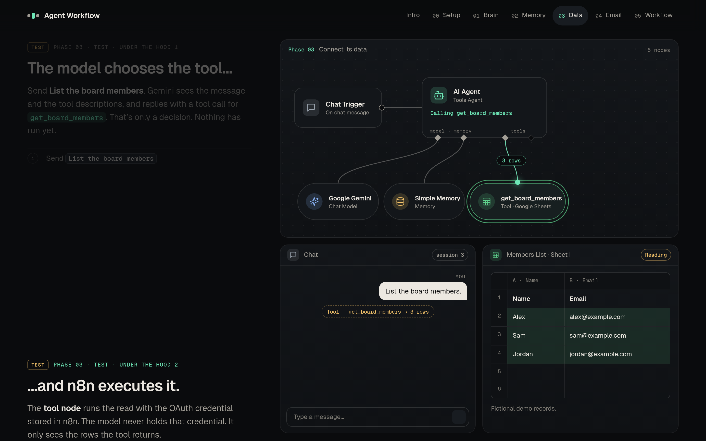<br><b>Phase 03 test.</b> The model chooses the tool, then n8n runs it.</td>
    <td>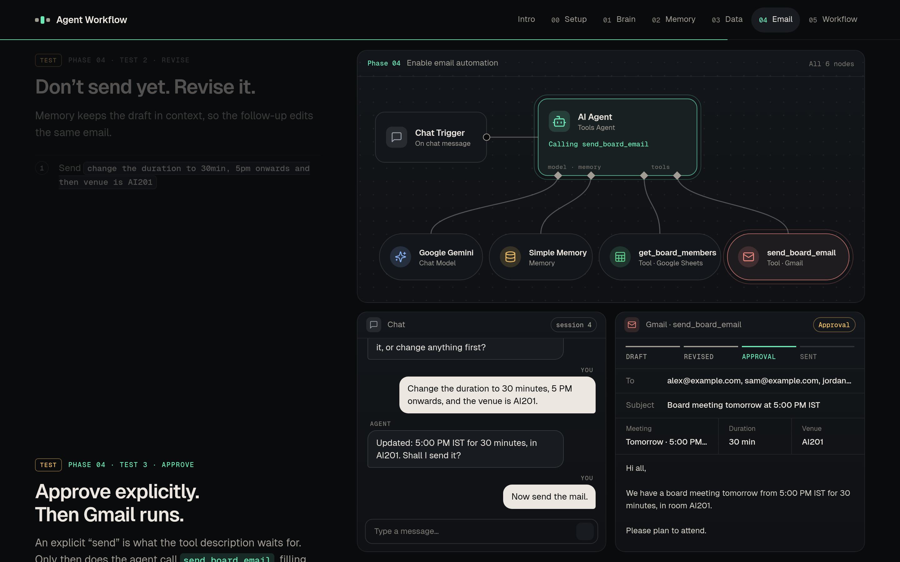<br><b>Phase 04 test.</b> Draft, revise, approve.</td>
  </tr>
  <tr>
    <td>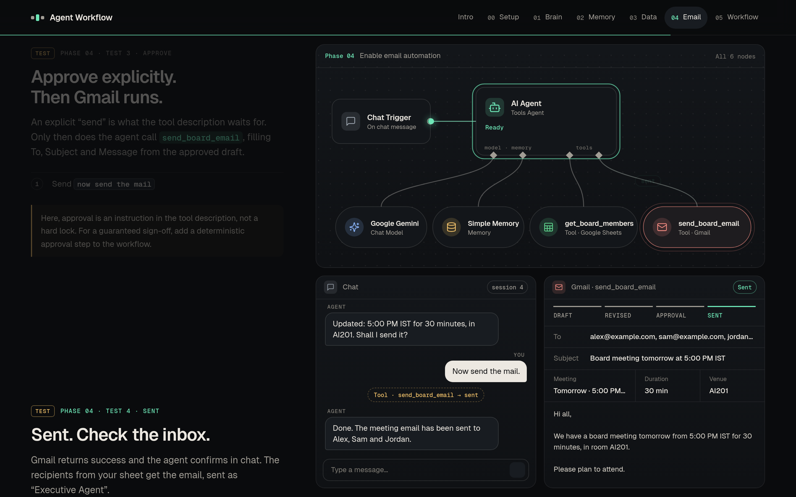<br><b>Phase 04 test.</b> The simulated send.</td>
    <td>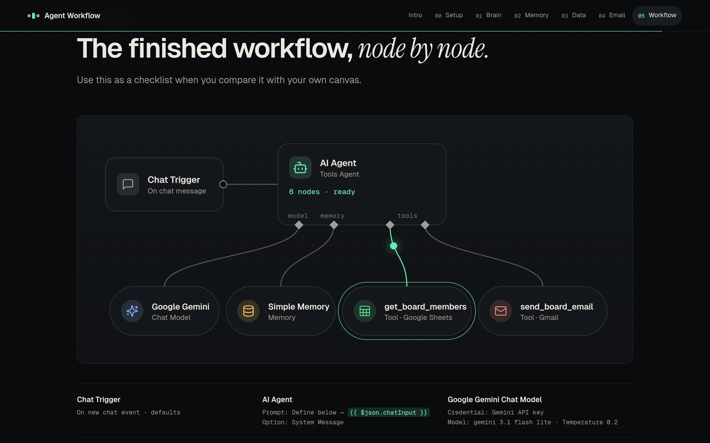<br><b>Reference.</b> The finished six-node workflow.</td>
  </tr>
</table>

**Responsive.** On phones the diagram is recomposed vertically and the lower pane switches between Chat and the node configuration.

<p>
  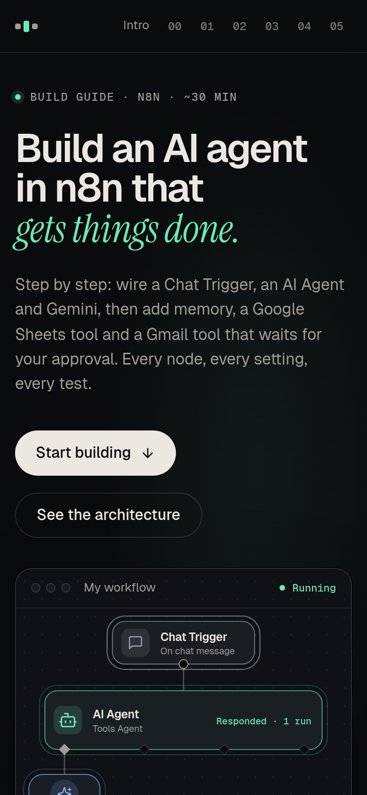
  &nbsp;
  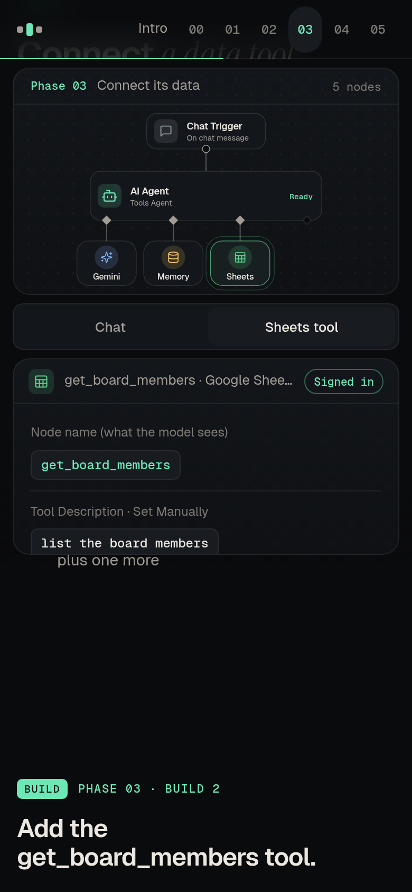
</p>

## Quick start

Requires Node.js 18+.

```bash
git clone https://github.com/CJ445/agent-workflow-explainer.git
cd agent-workflow-explainer
npm install
npm run dev          # http://localhost:5173
```

| Command | What it does |
|---|---|
| `npm run dev` | Start the Vite dev server |
| `npm run build` | Type-check, then build to `dist/` |
| `npm run preview` | Serve the production build on port 4173 |
| `npm test` | Run the content and consistency tests (Vitest) |
| `npm run lint` | Type-check only |
| `node scripts/e2e.mjs` | Run the browser checks against `npm run preview` (see below) |

## Architecture

```
src/
├── data.ts       Story model: every scroll step is a full snapshot of the scene
├── workflow.ts   SVG workflow renderer (desktop + compact layouts, packet animation)
├── panels.ts     Simulated chat, node config panes, memory store, sheet, Gmail compose
├── main.ts       GSAP ScrollTrigger wiring, chapter nav, progress, responsive swap
└── styles.css    Design tokens and layout
tests/            Content and consistency tests
scripts/e2e.mjs   Real-browser checks (puppeteer-core + system Chrome)
docs/project.md   Source-of-truth spec for the tutorial content
```

**Key design choices**

- **Declarative steps.** Each entry in `STEPS` describes the whole scene: visible nodes, active nodes, the route the packet travels, chat messages, which config pane is shown, and email state. Scrolling forward, scrolling back and jumping from the nav all resolve to the same state, with no sequence to replay.
- **One workflow renderer.** The hero, the sticky stage and the final diagram share a single SVG renderer, so the canvas looks the same everywhere and later phases visibly extend the earlier ones.
- **Native scroll.** The stage is CSS `position: sticky`. There is no scroll hijacking, and GSAP only observes scroll position.
- **Small stack.** Vite, TypeScript, GSAP and Lucide. Fonts are self-hosted (Fontsource), so the page makes no third-party requests.

## Testing

```bash
npm test                              # content tests
npm run build && npm run preview &    # then, in another shell:
node scripts/e2e.mjs                  # browser checks
```

**Unit tests** (`tests/steps.test.ts`) verify that:
- the phases appear in the order the spec defines, and the workflow only ever adds nodes;
- Gmail is never invoked before an explicit approval, and the email moves through `DRAFT → REVISED → APPROVED → SENT`;
- all example data is fictional (`@example.com`) and consistent across the chat, the sheet and the email;
- every build step has a click path, and exact names and values from the spec (`get_board_members`, `send_board_email`, `{{ $json.chatInput }}`, `gemini 3.1 flash lite`, temperature `0.2`) are present.

**Browser checks** (`scripts/e2e.mjs`) run at 1440×900 and 390×844 and verify forward and reverse scrolling, nav jumps, absence of horizontal overflow, reduced-motion behavior, cumulative layout shift below 0.1, that no requests go to Gmail, Sheets, Gemini or n8n, and that no API-key patterns appear in the rendered page. Set `CHROME=/path/to/chrome` if Chrome isn't at `/usr/bin/google-chrome`.

## Accuracy and limitations

- **Everything is simulated.** No n8n, Gemini, Google Sheets or Gmail call is made, and no email is sent. All names and addresses are fictional.
- **Approval is prompt-level.** In the spec, the "wait for approval" rule lives in the Gmail tool's description. The site says so plainly: it is guidance to the model, not a hard lock, and a deterministic approval step in the workflow is the way to guarantee sign-off.
- **Memory is session-scoped.** Simple Memory keeps recent turns for a chat session, and clearing the session clears them. The site doesn't claim a specific window size or permanent recall.
- **Some details are illustrative.** The Phase 04 draft uses `get_board_members` to find recipients, and the "forgets without memory" exchange in Phase 01 demonstrates stateless behavior. Neither is specified verbatim in `docs/project.md`.
- **Defaults to verify.** The Chat Trigger output fields, Simple Memory's default session setting, and the Gemini credential's name come from general n8n knowledge rather than the spec. Check them against your own n8n version.

## Accessibility

Semantic landmarks and headings, a skip link, keyboard-navigable chapter links with visible focus, and `aria-current` on the active chapter. `prefers-reduced-motion` turns off packet animation, transitions and the hero loop, and all content stays available as text. Information is never carried by animation alone.
